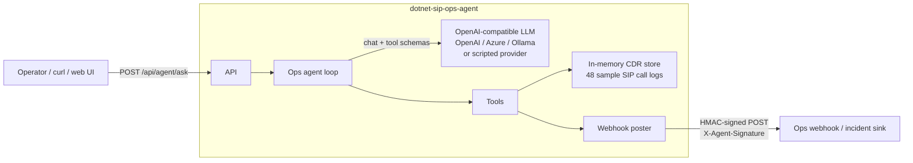
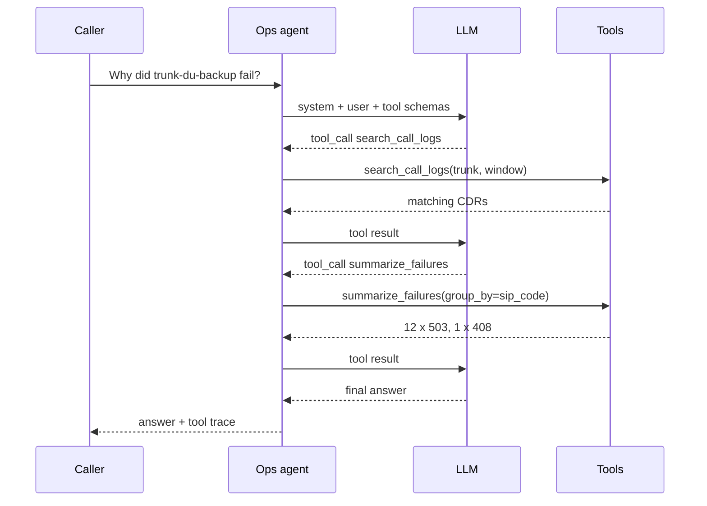

# dotnet-sip-ops-agent

[](https://github.com/AhmedElbashier/dotnet-sip-ops-agent/actions/workflows/ci.yml)


A **.NET 8** service that runs an **LLM agent with tool calling** over a set of sample **SIP/CDR call logs**.

You ask a question in plain language (`Why did trunk-du-backup fail this morning?`). The model is given four tools — search logs, fetch one call, summarize failures, and post a webhook alert — and an agent loop that executes whatever tool calls it returns, then feeds the results back until it produces a final answer.

The chat client talks to any **OpenAI-compatible** Chat Completions API (OpenAI, Azure OpenAI, [Ollama](https://ollama.com), LM Studio, vLLM). The default is a **scripted provider**: a deterministic planner used by CI, tests and the no-key quickstart. It is not an LLM, and the responses say so.

This is a public sample. The CDRs, numbers and trunks are fictional. It is not a production operations platform and it does not use real customer traffic.

| Concern | How it is handled |
|---|---|
| Tool calling | OpenAI `tools` / `tool_calls` on `/v1/chat/completions`, with a bounded agent loop (default 6 turns) |
| Model choice | Configurable base URL and model; bearer token sent only when `Llm:ApiKey` is set (Ollama does not need one) |
| Call data | 48 in-memory sample CDRs for one morning window, with a documented 503 incident on `trunk-du-backup` |
| Alerts | `post_webhook` posts a JSON alert, HMAC-SHA256 signed as `{timestamp}.{body}` when a secret is configured; dry-run if no URL is set |
| Testing without a key | 36 xUnit tests, including an eval suite that drives the agent with a queued mock model, plus a scripted provider for HTTP smoke tests |
| Ops | OpenAPI/Swagger UI, `/health/live`, `/health/ready`, a small web UI, multi-stage Dockerfile, non-root container |

## Architecture





## Tools

| Tool | What it does |
|---|---|
| `search_call_logs` | Filter sample CDRs by time window, caller, callee, direction, disposition, SIP code, trunk or hangup cause |
| `get_call` | Fetch one record by internal id (`cdr-20261124-0042`) or SIP Call-ID |
| `summarize_failures` | Aggregate matches by `sip_code`, `hangup_cause`, `trunk` or `disposition` |
| `post_webhook` | Post a structured alert (`title`, `severity`, `summary`, `call_ids`). Dry-run when `Webhook:Url` is empty |

The model is told not to invent call ids, counts or MOS scores. If a tool returns no rows, the answer should say so.

## Sample data

All 48 records fall between **24 Nov 2026, 08:00–12:00 Asia/Dubai** (04:00–08:00 UTC). Trunks: `trunk-du-primary`, `trunk-du-backup`, `trunk-intl`.

Documented invariants (also asserted in tests):

- 12 outbound **503 / `NORMAL_TEMPORARY_FAILURE`** calls on `trunk-du-backup` between 05:15Z and 05:40Z (ids `0001`–`0012`)
- 5 busy calls (486 / `USER_BUSY`)
- 4 no-answer (480), 3 cancelled (487), 2 unallocated numbers on `trunk-intl` (404), 2 request timeouts (408)
- `cdr-20261124-0018` is answered with poor quality (MOS 2.1, 8.5% loss)
- `cdr-20261124-0042` is an answered inbound call on `trunk-du-primary`, MOS 4.2, 187s

The remaining records are ordinary answered calls. One extra failed 408 also lands on `trunk-du-backup`, so a “failed on backup” query returns **13** calls: **12 x 503** and **1 x 408**.

## Quickstart

Requirements: [.NET 8 SDK](https://dotnet.microsoft.com/download/dotnet/8.0), or Docker.

```bash
dotnet run --project src/SipOpsAgent
# Development profile, http://localhost:8080
# Swagger at /swagger, small UI at /
```

The default provider is `scripted`, so this works without an API key:

```bash
./scripts/ask.sh 'Why did calls fail on trunk-du-backup this morning?'
./scripts/ask.sh 'Get details for cdr-20261124-0042'
./scripts/ask.sh 'Find all 486 busy calls and post a warning webhook.'
```

### Point it at Ollama

```bash
ollama pull llama3.1
# Ollama already exposes an OpenAI-compatible API at http://localhost:11434/v1

Llm__Provider=openai Llm__BaseUrl=http://localhost:11434/v1 Llm__Model=llama3.1 dotnet run --project src/SipOpsAgent
```

### Point it at OpenAI or Azure OpenAI

```bash
Llm__Provider=openai Llm__BaseUrl=https://api.openai.com/v1 Llm__Model=gpt-4o-mini Llm__ApiKey=sk-... dotnet run --project src/SipOpsAgent
```

For Azure OpenAI, set `Llm__BaseUrl` to the deployment’s `/v1` endpoint (or the Azure OpenAI-compatible base URL you already use) and `Llm__ApiKey` to the key. No OpenAI-specific SDK is required; the client is a thin HTTP wrapper around `POST /chat/completions`.

## Demo output

Captured against the scripted provider (full session in [`docs/demo-session.txt`](docs/demo-session.txt)):

```text
$ curl -sS http://localhost:8080/health/ready | jq
{
  "status": "ready",
  "records": 48,
  "provider": "scripted",
  "model": "scripted-planner"
}

$ ./scripts/ask.sh 'Why did calls fail on trunk-du-backup this morning?'
provider: scripted  model: scripted-planner  turns: 2
tools: search_call_logs -> summarize_failures -> final answer
--- answer ---
Scripted provider (not an LLM). Findings from tool results:

Search returned 13 call(s) (trunk=trunk-du-backup, disposition=Failed).

Summary: 13 matched (answered 0, failed 13, busy 0, no-answer 0, cancelled 0), grouped by sip_code: 12 x 503, 1 x 408.

$ ./scripts/ask.sh 'Get details for cdr-20261124-0042'
tools: get_call -> final answer
Call cdr-20261124-0042: Inbound Answered SIP 200 / NORMAL_CLEARING on trunk-du-primary,
caller +971500100042 -> +971400100100, duration 187s, MOS 4.2, loss 0.2%.
```

## Configuration

| Setting | Default | Meaning |
|---|---|---|
| `Llm:Provider` | `scripted` | `scripted` or `openai` (any OpenAI-compatible host) |
| `Llm:BaseUrl` | `http://localhost:11434/v1` | Must include the `/v1` suffix |
| `Llm:Model` | `llama3.1` | Passed through as `model` |
| `Llm:ApiKey` | empty | Optional. Sent as `Authorization: Bearer` only when set |
| `Llm:Temperature` | `0` | |
| `Llm:TimeoutSeconds` | `60` | |
| `Webhook:Url` | empty | Alert destination. Empty = dry-run (still recorded in the in-memory sink) |
| `Webhook:HmacSecret` | empty | When set, `X-Agent-Signature` is hex HMAC-SHA256 of `{timestamp}.{body}`; `X-Agent-Timestamp` is Unix seconds |
| `Agent:MaxTurns` | `6` | Safety cap on the tool loop |
| `Agent:EnableDevSink` | `true` in Development / Docker | Exposes `GET/POST /api/dev/webhook-sink` for demos and CI |

Environment variables use the usual ASP.NET Core double-underscore form, e.g. `Llm__Provider=openai`.

## HTTP API

| Method | Path | Purpose |
|---|---|---|
| `POST` | `/api/agent/ask` | `{ "question": "..." }` → answer, provider, model, turns, tool trace |
| `GET` | `/api/tools` | Tool names, descriptions and JSON schemas |
| `GET` | `/api/calls` | Direct CDR search (query string filters) |
| `GET` | `/api/calls/{callId}` | One CDR |
| `GET` | `/health/live`, `/health/ready` | Liveness and readiness (`ready` reports 48 records and the active provider) |
| `GET` | `/swagger` | OpenAPI UI |
| `GET` | `/` | Minimal ask UI |

## Tests and evals

```bash
dotnet test -c Release
# Passed!  - Failed: 0, Passed: 36, Skipped: 0, Total: 36
```

The suite does **not** call a real model and does not need an API key.

- Store and tool tests lock the sample-data invariants (12 x 503 on the backup trunk, featured call MOS 4.2, and so on)
- `OpenAiCompatibleChatClient` is tested with a fake `HttpMessageHandler`: tool schemas are serialized, tool calls are parsed, and a bearer token is sent only when a key is configured
- The webhook poster signs and verifies HMAC headers
- The agent loop is driven by a queued mock model (pre-canned `tool_calls`, then a final answer)
- A small **eval** folder runs end-to-end scenarios: explain the backup-trunk incident, look up a call, post a 486 alert, and refuse to invent a missing CDR
- `WebApplicationFactory` covers the HTTP API, including a scripted ask that lands in the dev webhook sink

CI also builds a container and smokes `/health`, the calls API, a scripted `/api/agent/ask`, and the webhook sink — still without a key.

## Docker

```bash
docker compose up --build
# http://localhost:8080  (scripted provider, dev sink enabled)
```

The image is a multi-stage build, listens on `8080`, and runs as a non-root user.

## Project layout

```text
src/SipOpsAgent/          ASP.NET Core 8 host, agent loop, tools, LLM client
tests/SipOpsAgent.Tests/  xUnit + WebApplicationFactory + eval scenarios
docs/demo-session.txt     Captured scripted-provider session
scripts/ask.sh            Tiny curl helper
Dockerfile                Multi-stage, non-root
docker-compose.yml        Scripted quickstart
```

## License

[MIT](LICENSE) © 2026 Ahmed Elbashier
